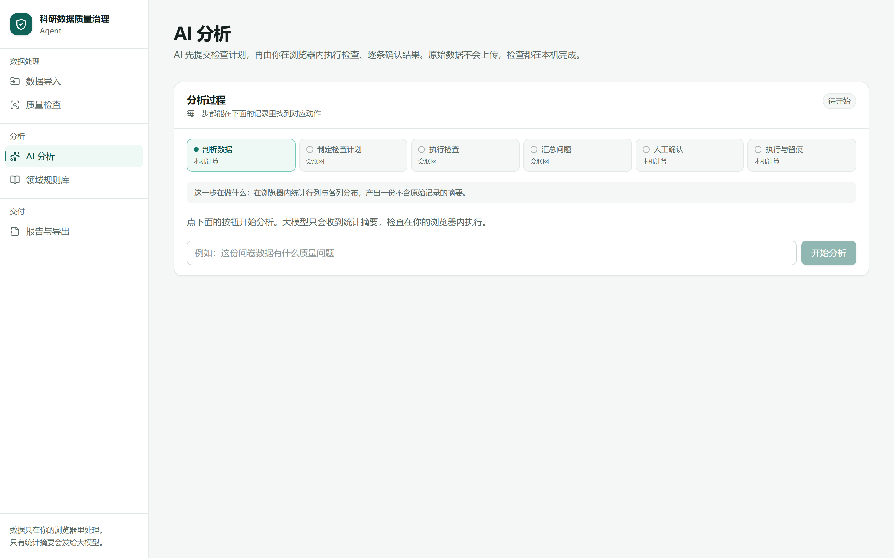
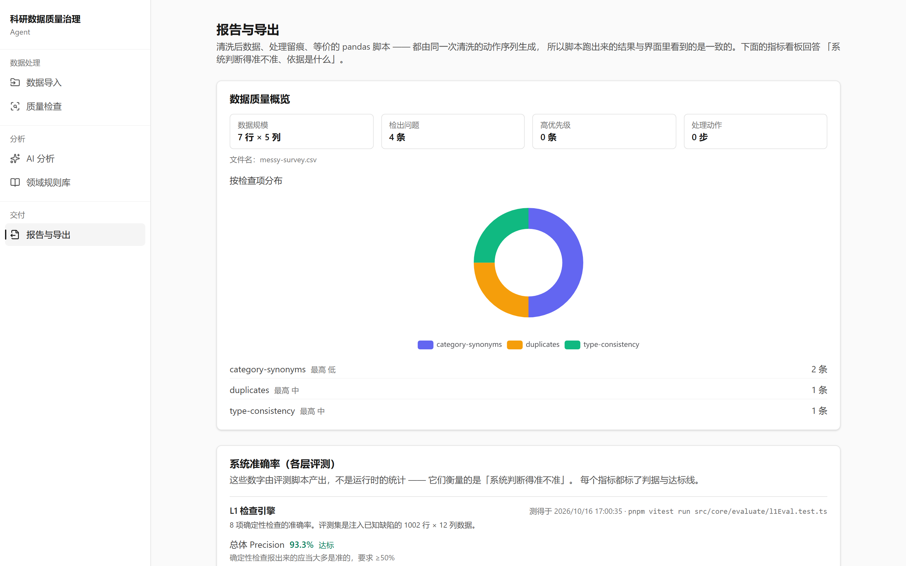

# 科研数据质量治理 Agent —— 作品介绍文档

**团队名称**：跟党走就队1　**参赛组别**：B组　**所属院校**：哈尔滨信息工程学院 软件学院
**团队成员**：罗涛（队长，代码开发与部署）、尚尔轩（知识库整理）　**指导教师**：满国晶 讲师

**在线演示地址**：https://www.ai-web.me
**代码仓库**：https://github.com/HUA-T-SVG/AI-web

---

## 一、项目详情及使用方式

### 1.1 项目要解决的问题

高校科研团队处理问卷、实验记录时，数据质量工作大量依赖 Excel 手工核查：缺失值、越界值、重复行、单位写法不一致、编码含义不清（例如 999 是缺考还是真实成绩）等问题反复出现，处理口径散落在文档和聊天记录里，清洗过程不可追溯。另一方面，团队愿意尝试 AI，但**不敢把原始数据上传到第三方**；通用大模型给出的结论又常常缺少可核对的依据。

本项目是一个**浏览器优先的数据质量治理 Agent**：数据的解析、画像、检查、清洗全部在本地完成，AI 只接收结构摘要；AI 提出的结论分为「仅展示 / 待核对 / 建议清洗」三类，每条都要求人类确认；清洗必须选择口径、填写理由、执行留痕，最终生成可复现的报告。

### 1.2 使用方式

1. **导入数据**：打开首页，拖入 CSV / XLSX 文件，或使用内置示例数据；文件在浏览器内解析，显示数据预览、列画像与本地处理声明。
2. **质量检查**：进入「质量检查」，运行 8 项确定性检查；在覆盖地图中查看每个字段的「已覆盖 / 未覆盖 / 下一步」情况。
3. **确认数据字典**：粘贴数据字典原文，AI 只抽取候选规则（范围、允许值、缺失占位码），由用户逐条核对后确认；确认后只重检对应字段。
4. **AI 分析**：进入「AI 分析」，输入分析要求；AI 先提交检查计划，用户可取消或调整检查项，确认后才执行本地检查并逐条提交结论。
5. **人工审阅**：逐条查看「仅展示 / 待核对 / 建议清洗」结论与证据；对需要核对的条目点「人工核对」并留备注；对可试算的清洗建议展开「对比清洗口径」，比较两种口径的影响后再采用。
6. **执行与交付**：确认后执行清洗（原始数据不变、可撤销），在报告页导出可读报告、Word、清洗后 CSV、处理留痕 JSON 以及与界面行为等价的 pandas 脚本。

线上演示地址为 https://www.ai-web.me ；也可以在本地运行源码（`pnpm install && pnpm dev`，环境变量见 `.env.example`），本地运行同样可以把数据留在浏览器内。

---

## 二、项目亮点

1. **数据不出浏览器，AI 只拿摘要**：解析、画像、检查、清洗均在本地（Worker / IndexedDB）完成；出站内容只有结构摘要、脱敏后的字段信息与用户主动粘贴的字典文本，出站内容可审计。
2. **三种处理决定，不把“建议”伪装成“结论”**：每条 AI 结论必须标注 `inform_only`（仅展示）、`needs_clarification`（待核对）或 `propose_cleaning`（建议清洗）；待核对字段在本轮被锁定，不允许悄悄清洗。
3. **证据账本可追溯**：每条结论绑定本地检查短 ID（`C-`）与规则检索短 ID（`R-`）；点开「核对依据」能看到证据原文、涉及行号，可直接定位到原表，AI 的解释文字单独标记「待核对」——系统只验证结构化引用，不替模型背书。
4. **清洗口径可比较、由人决定**：对缺考码（如 999）提供「转为缺失 / 保留并标记复核」两种口径的本地试算，同屏显示有效样本、缺失率与均值变化；用户选择口径并填写理由后才可执行，执行结果与理由进入报告与留痕。
5. **覆盖地图如实标注缺口**：语义模型降级、值域规则未配置、跨表检查未支持等情况都会写成「未覆盖」并给出下一步，而不是用“没有发现问题”暗示“全部检查通过”。
6. **全链路可复现**：报告附数据指纹、数据版本、规则来源与处理记录；同一份数据、同一版口径重跑，结论与导出结果一致。
7. **评测驱动开发**：建立了 L1–L5 评测体系与“有无 RAG”配对对照，关键指标和真实模型冒烟都有可复现产物，结论不好看的指标也照实保留。

---

## 三、AI 测试技术落地使用情况概述

本项目把「AI 生成结论」拆成可测试的链路：本地检查用于验证事实，Agent 层用契约与执行器拦截非法动作，评测层用数据注入和重放验证效果。

- **单元与集成测试**：83 个测试文件、935 项测试通过（另有 10 项按设计跳过），覆盖检查库、清洗执行、报告口径、Agent 工具契约、批处理策略等。
- **端到端测试**：Playwright 覆盖 6 个页面与关键流程（导入、检查、字典、分析、审阅、执行、导出），共 80 项用例；另有真实模型冒烟，抓取线上 SSE 工具调用与截图作为证据。
- **L1 确定性检查评测**：在基准数据集上注入 4 类缺陷，检查精确率 93.3%、召回率 100%。
- **L3 规则检索评测**：178 条知识库规则（通用 126 + 学科 52）上，Top-5 命中率 100%；同时保留「有无 RAG」的配对对照，如实记录语义检索带来与未带来的差异。
- **L5 性能评测**：5 万行 × 50 列数据，画像约 965 ms、检查约 3453 ms，在预算内。
- **Agent 层评测**：12 个关键词用例中，3 个轮次触发上下文截断——这是当前已知局限，已在报告中标注，不隐藏。
- **知识库质量**：178 条规则中，团队已核对 104 条、待核对 74 条；界面按核对状态展示，不把待核对规则当作确定结论。

这些评测产物都随仓库提供（`knowledge/reports/`、`public/eval/`），并可在本地重新运行。

---

## 四、项目中涉及的关键技术

| 方向 | 关键技术 |
| --- | --- |
| 前端框架 | Next.js 16 App Router、React 19、TypeScript strict、Zustand 状态管理 |
| AI Agent | AI SDK v7 流式对话与工具调用、SSE 服务端接口、Zod 运行时契约、多步工具编排 |
| 本地计算 | Web Worker（解析 / 画像 / 检查 / 同义词）、IndexedDB 本地暂存、数据版本与快照冻结 |
| 语义能力 | ONNX Runtime Web + bge-small-zh 本地嵌入模型，浏览器内语义归并；模型不可用时明确降级 |
| 数据核心 | 平台无关的纯 TypeScript `core/`（检查、清洗、报告口径），浏览器与脚本共用同一实现 |
| 交付物生成 | Word 报告、清洗后 CSV、处理留痕 JSON、与界面等价的 pandas 清洗脚本 |
| 测试与评测 | Vitest 单元测试、Playwright 端到端、数据缺陷注入、L1–L5 评测、真实模型冒烟 |
| 部署 | Vercel 线上部署 + 本地兜底；敏感密钥只存在服务端环境变量 |

---

## 五、项目相关图片

---

## 六、项目之前是否发表过或获奖

截至提交之日，本项目**未公开发表、未参加其他赛事、未获得任何奖项**，本次传智杯为首次参赛。

项目使用的第三方开源库（Next.js、AI SDK、Transformers.js、ONNX Runtime、ECharts、docx 等）均在 README 与技术文档中列明，未直接复制其他项目的业务代码。

---

## 七、是否在其他项目基础上优化

本项目为团队独立设计与实现，**不是在其他项目基础上二次开发的**。

需要说明的是，项目在技术选型上参考了公开的开源生态与通用工程实践（例如用 Next.js 做全栈、用 AI SDK 做工具调用、用 ONNX Runtime Web 做浏览器内推理），并针对“科研数据治理”场景做了完整设计：数据本地化边界、三种处理决定、口径对比试算、人工核对与处理留痕、覆盖地图与 L1–L5 评测体系，这些均为本项目针对赛题场景的原创实现。

---

*本文档与《技术文档》配套使用；技术细节、代码结构与可复现的评测命令见技术文档正文。*
