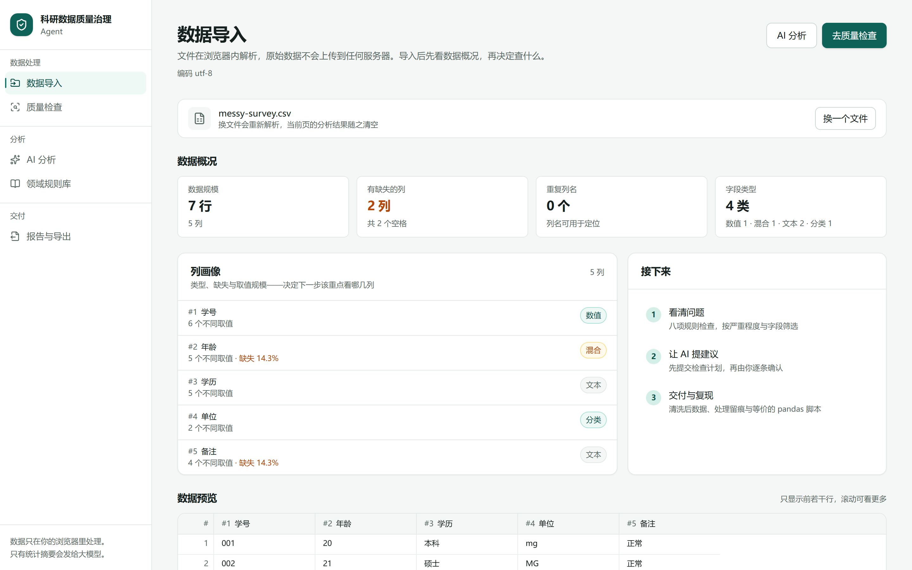
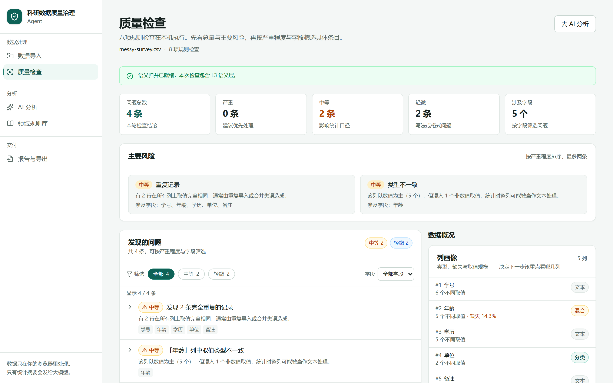
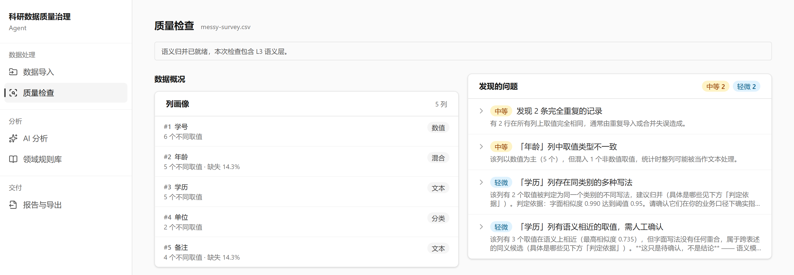
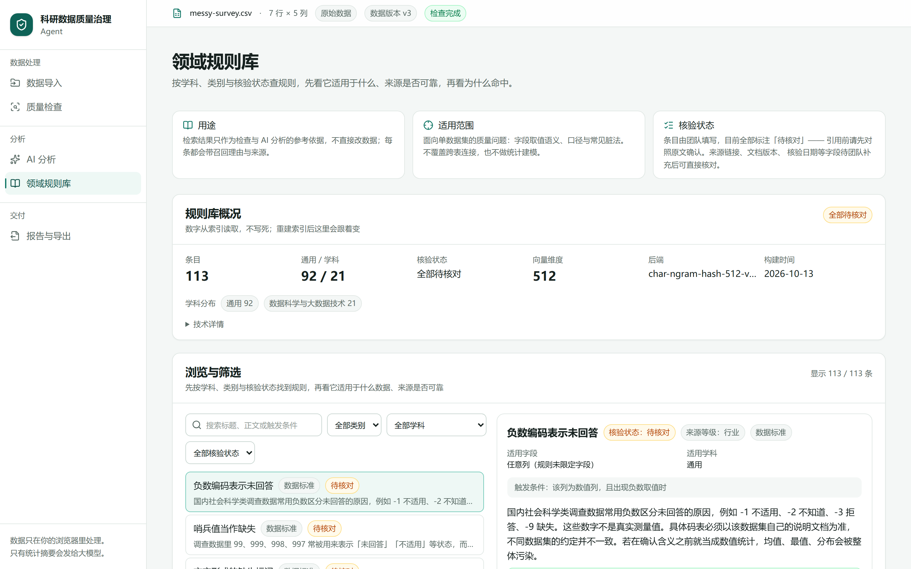

# 科研数据质量治理 Agent —— 作品介绍文档

**团队名称**：跟党走就队1　**参赛组别**：B组　**所属院校**：哈尔滨信息工程学院 软件学院
**团队成员**：罗涛（队长，代码开发与部署）、尚尔轩（知识库整理）　**指导教师**：满国晶 讲师

**在线演示地址**：https://www.ai-web.me
**代码仓库**：https://github.com/HUA-T-SVG/AI-web

---

## 作品摘要

本项目是一个**浏览器优先的数据质量治理 Agent**，面向高校科研团队处理问卷、实验记录与教学数据的场景。它把“数据能不能交给 AI”这个问题拆成两层：**数据层的解析、画像、检查、清洗全部在浏览器本地完成，原始数据一行都不出浏览器；AI 层只接收结构摘要**，负责提出检查计划与处理建议。AI 的每条结论都必须标注处理决定（仅展示 / 待核对 / 建议清洗），并绑定可定位的本地证据；清洗必须由人选择口径、填写理由后才执行，全过程留痕，最终生成可复现的报告。

作品的目标不是“让 AI 自动把数据洗干净”，而是**让 AI 的建议可核对、可拒绝、可追溯**——在科研场景里，可信比自动化更重要。

---

## 一、项目详情及使用方式

### 1.1 要解决的问题

科研数据质量工作长期依赖 Excel 手工核查，典型痛点有四类：

1. **重复劳动多**：缺失值、重复行、越界值、异常值、单位写法不一致等问题反复出现，每次换一份数据都要重新检查；
2. **口径散落**：数据字典写在文档里（“999 表示缺考”“成绩 0–100 分”），检查时靠人记，不同人理解不一致；
3. **AI 不敢用**：通用大模型需要上传原始数据，涉及未发表数据和受访者隐私，团队不敢传；即便传了，模型结论也缺少可核对的依据；
4. **清洗不可追溯**：改过的数据没有记录“为什么改、按什么口径改”，报告里说不清处理过程。

本项目针对这四类问题设计：本地确定性检查解决“重复劳动”、数据字典结构化解决“口径散落”、本地化 AI 边界解决“不敢用”、证据账本与处理留痕解决“不可追溯”。

### 1.2 目标用户与使用场景

- **目标用户**：高校教师、研究生、本科生科研团队，以及负责问卷/实验数据整理的数据管理员；
- **典型场景**：问卷数据清洗（缺失、越界、单位不一致）、实验记录整理（重复、异常值）、课程作业数据质量检查、论文附录的数据处理说明；
- **不适用场景**：需要跨表/跨库关联校验、需要自动修改原始数据的全自动流水线、需要上传原始记录到云端的协作场景——这些边界在界面与文档中如实标注。

### 1.3 系统能力总览

系统由 5 个工作页面 + 1 个根路径入口组成：

| 页面 | 主要能力 |
| --- | --- |
| 数据导入 | CSV/XLSX 本地解析、数据预览、列画像、示例数据与本地暂存恢复 |
| 质量检查 | 8 项确定性检查、覆盖地图、数据字典生成规则、单字段重检 |
| 领域规则库 | 178 条领域规则检索与阅读、规则来源与核对状态、试跑检索（RAG 现场验证） |
| AI 分析 | 检查计划确认、逐条结论提交、三种处理决定、证据核对、人工核对、口径对比与清洗执行 |
| 报告与导出 | 可读报告、Word/打印、清洗后 CSV、处理留痕 JSON、pandas 脚本、指标看板 |

8 项确定性检查为：缺失值、重复行、类型一致性、值域规则、离群值、单位一致性、类别同义词、列名规范。

### 1.4 使用方式（按钮级说明）

1. **导入数据**：打开首页，拖入 CSV/XLSX 或选择文件；页面显示预览、列画像与“原始数据不会上传”的声明。支持从本地暂存恢复上次数据，并明确标记“这是恢复的数据”。
2. **运行检查**：进入「质量检查」，8 项检查在 Web Worker 中执行；在「检查覆盖地图」中查看每个字段的已覆盖/未覆盖情况与下一步建议。
3. **确认数据字典**：展开「从数据字典生成检查规则」，粘贴字典原文（如“成绩：允许范围 0–100 分；成绩：999 表示缺考”），点「AI 提取候选规则」；系统按类型列出候选（范围/允许值/缺失占位码），用户逐条核对、选择匹配列、勾选后点「确认并应用所选规则」；确认后只重检对应字段。
4. **AI 分析**：进入「AI 分析」，输入分析要求；AI 先调用 `plan_checks` 提交检查计划，用户可取消不需要的检查项，点「按此计划执行」后，本地 Worker 执行检查，AI 再逐条调用 `submit_issue` 提交结论。
5. **人工审阅**：每条结论标注 `inform_only`（仅展示）、`needs_clarification`（待核对）或 `propose_cleaning`（建议清洗）；可展开「核对依据」查看本地证据与涉及行号，点行号定位到原表；对需要人确认的条目可点「人工核对」并填写备注，标记只记录“人看过”，不改数据。
6. **口径对比与执行**：对缺考码等可试算建议，展开「对比清洗口径」，本地试算“转为缺失 / 保留并标记复核”两种口径的有效样本、缺失率与均值变化；选择口径、填写理由、点「采用此口径」，再点「执行清洗」；执行后显示改动单元格数，报告与处理留痕记录口径、理由与结果。
7. **导出与报告**：在「报告与导出」页查看可读报告、下载 Word、导出清洗后 CSV、处理留痕 JSON 和与界面行为等价的 pandas 脚本；指标看板展示 L1–L5 评测结果与“有无 RAG”的配对对照。

### 1.5 数据与隐私边界

- 原始数据、列画像、检查结果、清洗结果全部保存在浏览器（内存 + IndexedDB 本地暂存），不上传服务器；
- 出站内容只有：数据摘要（行列数、类型、统计量）、脱敏后的字段信息、用户主动粘贴的数据字典文本；
- API Key 只存在服务端环境变量（`.env.local` 不提交仓库），前端不接触密钥；
- 语义模型不可用时明确降级提示，不假装“已经做了语义检查”。

### 1.6 运行方式

- **线上**：直接访问 https://www.ai-web.me ，无需安装；
- **本地**：`cd 02-作品源码 && pnpm install && cp .env.example .env.local`（填写密钥）`&& pnpm dev`，打开 http://localhost:3000 ；
- 仅运行本地检查不需要 API Key；AI 分析需要配置服务端密钥。

---

## 二、项目亮点

1. **数据不出浏览器，AI 只拿摘要**：从架构上把“数据面”和“AI 面”分开。解析、画像、检查、清洗在本地 Worker 完成；发送给模型的只有统计摘要与用户主动粘贴的字典文本，出站内容可审计。对科研数据来说，这是能不能用 AI 的前提。
2. **结论分为三种处理决定，不把“建议”伪装成“结论”**：每条 AI 结论必须标注 `inform_only` / `needs_clarification` / `propose_cleaning`；待核对字段在本轮被锁定，不允许悄悄清洗；没有可执行建议时如实显示“本轮没有可执行的清洗动作”，而不是硬造一个动作。
3. **证据账本让每条结论可核对**：结论绑定本地检查短 ID（`C-`）与规则检索短 ID（`R-`）；「核对依据」展示证据原文、涉及行数，行号可定位原表；AI 自己的解释文字单独标「待核对」——系统只验证结构化引用，不替模型背书。
4. **清洗口径可比较、由人决定**：缺考码（如 999）提供“转为缺失 / 保留并标记复核”两种口径的本地试算，同屏显示有效样本、缺失率与均值变化；选择口径、填写理由后才允许执行，结果进入报告与处理留痕。
5. **覆盖地图如实标注缺口**：语义模型降级、值域规则未配置、跨表检查未支持等情况写成“未覆盖”并给下一步，避免用“没有发现问题”暗示“全部检查通过”。
6. **全链路可复现**：报告附数据指纹、数据版本、规则来源与处理记录；同一份数据、同一版口径重跑，结论与导出结果一致；导出的 pandas 脚本与界面清洗行为等价，方便论文附录复现。
7. **评测驱动开发**：建立 L1–L5 评测体系与“有无 RAG”配对对照，关键指标可复现；指标不好看的部分（如 Agent 截断 3/12、待核对知识库 74 条）照实保留，不用漂亮话掩盖。

---

## 三、AI 测试技术落地使用情况概述

### 3.1 AI 在系统中的落地方式

- **多步 Agent + 工具调用**：AI 通过 `plan_checks` 提交检查计划、`run_checks` 请求本地执行、`submit_issue` 逐条提交结论；服务端以 SSE 流式返回，前端用 AI SDK 的 `useChat` 接入；
- **执行器兜底**：工具调用先过 Zod 运行时契约，再由生产执行器校验列名、checkId、证据 ID、条数上限（最多 8 条）；模型编造字段或工具会被拒绝并收到可读错误，自动纠正；
- **本地检查与 AI 分离**：事实由本地 8 项确定性检查产出，AI 只负责“提出计划、解释现象、给建议”，事实与解释不混在一个黑盒里；
- **降级可见**：语义模型不可用、值域未配置、检索未命中时，界面逐项显示降级原因，不静默失败。

### 3.2 五层评测体系（L1–L5）

| 层级 | 评测对象 | 指标 | 结果 | 判据 |
| --- | --- | --- | --- | --- |
| **L1** | 确定性检查引擎 | 精确率 / 召回率 | **93.3% / 100%** | 本作品自定 Precision ≥0.50、Recall ≥0.90；两项达标（14 条计分缺陷 + 4 条对照，样本小，仅作基线） |
| **L2** | 类别同义归并自动档 | Precision / Recall / F0.5 | 自动阈值 0.95 处 Precision **1.0000** / Recall **0.0561**；待确认档（0.84）Precision 0.8036 / Recall 0.4206 | spec 要求自动档 Precision ≥0.95；达标，但召回低，因此产品主要由“待确认档”承担实际体验，且不自动改数据 |
| **L3** | 领域规则检索 | Hit@1 / Hit@5 / MRR | **84.2% / 100.0% / 0.9123** | 自定 Hit@5 ≥0.90、MRR ≥0.70；达标（21 条查询，19 条有期望命中） |
| **L4** | Agent 工作流 | 工具成功率 / 轮次 / 截断率 / 失败恢复 | 截断从 6/12 收敛到 **3/12**（全部来自越界请求），**尚未零截断** | spec 未给数值线：只报观测值，不报“达标”结论 |
| **L5** | 系统性能与成本 | 剖析 / 检查耗时、出站 token 与成本 | 5 万行 × 50 列：剖析 **965 ms**、全量检查 **3453 ms** | spec：剖析 ≤3 s、检查 ≤30 s；达标（测量条件见报告，关闭 dev server 后测量） |

评测产物随仓库提供：`knowledge/reports/eval-l1.md`、`eval-retrieval.md`、`eval-agent.md`、`eval-system.md`、`eval-rag-comparison.md`，界面看板读取最新一次结果。

### 3.3 测试工程落地

- **单元/集成测试**：83 个测试文件、**935 项通过**（另有 10 项按设计跳过），覆盖检查库、清洗执行、报告口径、Agent 工具契约、批处理策略、数据字典、证据账本等；
- **端到端测试**：Playwright 覆盖 6 个页面与关键流程（导入、检查、字典、分析、审阅、执行、导出、持久化、响应式），共 **80 项用例**；
- **真实模型冒烟**：对线上环境跑真实模型，抓取 `/api/agent` 的 SSE 工具调用与截图，验证“3 种处理决定同屏、可试算卡不出现误导性接受按钮、人工核对可标记与撤销”等行为；
- **回归纪律**：每次改动执行 `tsc` + 单测 + 相关 E2E（本轮针对批处理/分析/字典的 37 项定向回归），避免“改一个功能、坏另一条路径”。

### 3.4 评测发现与已知局限（如实说明）

- **L1 样本小**：14 条计分缺陷 + 4 条对照只是基线，不能外推为通用准确率；
- **L2 自动档召回极低**（0.0561）：产品因此以“待确认”为主，自动改数据被刻意限制；
- **L3 学科覆盖有限**：21 条查询中只有 8 条学科专属查询，测试集目前只覆盖一个学科；
- **L4 未零截断**：12 次对话中 3 次触发截断，越界请求仍会继续查质量，`submit_issue` 一条一轮也带来轮次成本；
- **知识库未全部核对**：178 条规则中已核对 104 条、待核对 74 条，界面按核对状态展示，不把待核对规则当确定结论；
- **测量条件敏感**：L5 性能在 dev server 占用 CPU 时会明显变慢，报告保留 min/max 与测量条件，避免把测量污染当实现回归。

### 3.5 如何复现

```bash
pnpm test                 # 单元/集成测试
pnpm test:e2e             # Playwright 端到端（需本地启动）
pnpm test src/core/evaluate/l1Eval.test.ts       # L1
pnpm test src/knowledge/retrievalEval.test.ts    # L3
pnpm eval:l5              # L5 性能（默认套件之外）
pnpm eval:agent           # L4 Agent 工作流
```

---

## 四、项目中涉及的关键技术

### 4.1 架构分层

- **`core/`（平台无关纯 TypeScript）**：检查、清洗、画像、报告口径、评测指标。浏览器、Node 脚本与评测共用同一份实现，从架构上避免“界面结果”和“导出脚本结果”不一致；
- **`src/agent/`**：服务端 Agent（工具定义、执行器、Prompt、消息脱敏）与共享契约；前端不直接持有密钥；
- **`src/ui/`**：Next.js 页面与组件、Zustand 状态、Worker 客户端、证据/审阅/报告视图；
- **`src/parser`、`src/worker`**：解析与计算 Worker，隔离主线程；
- **`src/knowledge`**：规则库加载、稀疏检索与语义检索、评测。

### 4.2 关键技术点

| 方向 | 技术 |
| --- | --- |
| 前端框架 | Next.js 16 App Router、React 19、TypeScript strict、Zustand |
| AI Agent | AI SDK v7 流式对话与工具调用、SSE 服务端接口、Zod 运行时契约、多步工具编排 |
| 本地计算 | Web Worker（解析/画像/检查/同义词）、IndexedDB 本地暂存、数据版本与快照冻结 |
| 语义能力 | ONNX Runtime Web + bge-small-zh 本地嵌入，浏览器内语义归并；不可用时显式降级 |
| 证据与口径 | 证据短 ID（C-/R-）、三种处理决定、待核对锁列、口径对比试算、处理留痕 |
| 交付物 | Word 报告、清洗后 CSV、留痕 JSON、与界面等价的 pandas 脚本 |
| 测试与评测 | Vitest、Playwright、缺陷注入数据集、L1–L5 评测、真实模型冒烟 |
| 部署与安全 | Vercel 线上部署、本地兜底、密钥仅服务端环境变量、出站内容白名单 |

### 4.3 关键设计取舍

- **为什么不让 AI 直接写规则**：规则由“字典文本 → 候选 → 人确认”产生，AI 只做抽取；本地校验与人工确认保证规则可解释；
- **为什么口径变化必须重新分析**：每轮分析开始时冻结数据版本与口径快照，把新口径塞进旧轮会让“这批结论按哪版口径跑的”说不清；
- **为什么保留“仅展示/待核对”**：科研场景里“不确定”本身是有效结论；强行给动作会制造假确定性。

---

## 五、项目相关图片











---

## 六、项目之前是否发表过或获奖

截至提交之日，本项目**未公开发表、未参加其他赛事、未获得任何奖项**，本次传智杯为首次参赛。

项目使用的第三方开源库（Next.js、AI SDK、Transformers.js、ONNX Runtime、ECharts、docx、papaparse、read-excel-file 等）均在 README 与技术文档中列明，遵循各自许可证；业务代码与界面设计为团队原创，未直接复制其他项目的业务实现。

---

## 七、是否在其他项目基础上优化

本项目为团队独立设计与实现，**不是在其他项目基础上二次开发的**。

需要区分“技术选型参考”与“项目二开”：项目在技术选型上参考了公开的开源生态与通用工程实践（Next.js 全栈、AI SDK 工具调用、ONNX Runtime Web 浏览器推理），但“科研数据治理”场景下的完整设计——数据本地化边界、三种处理决定、待核对锁列、证据账本、口径对比试算、人工核对与处理留痕、覆盖地图、L1–L5 评测体系——均为本项目针对赛题场景的原创实现。

与通用工具相比，本项目的差异点在于：

- 通用 Excel 检查工具只做规则检查，不解决“口径从文档到规则”和“AI 建议可核对”的问题；
- 通用 LLM 数据清洗工具通常把数据上传云端、直接给清洗动作，缺少本地证据与人工确认环节；
- 本项目把“本地事实 + AI 建议 + 人工决定 + 留痕报告”串成闭环，并用评测与真实模型冒烟验证行为，而不是只验证 demo 能跑。

---

## 八、团队分工与可复现材料

| 成员 | 分工 |
| --- | --- |
| 罗涛（队长） | 代码开发、架构与部署、评测与测试、文档 |
| 尚尔轩 | 知识库整理、规则核对、数据与领域知识 |

可复现材料在作品包内：

- `01-作品文档`：技术文档、作品介绍文档（PDF + Word）；
- `02-作品源码`：完整的 Next.js 源码、测试、知识库与评测产物（含本地模型与 ORT 运行文件）；
- `作品说明.txt`：团队信息、在线地址、运行方式与剔除清单。

---

*本文档与《技术文档》配套使用；技术细节、代码结构与可复现的评测命令见技术文档正文。*
