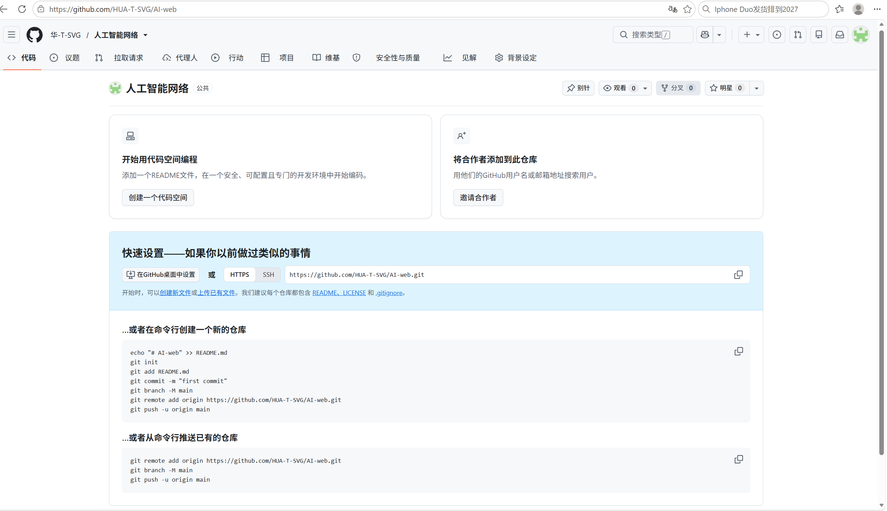
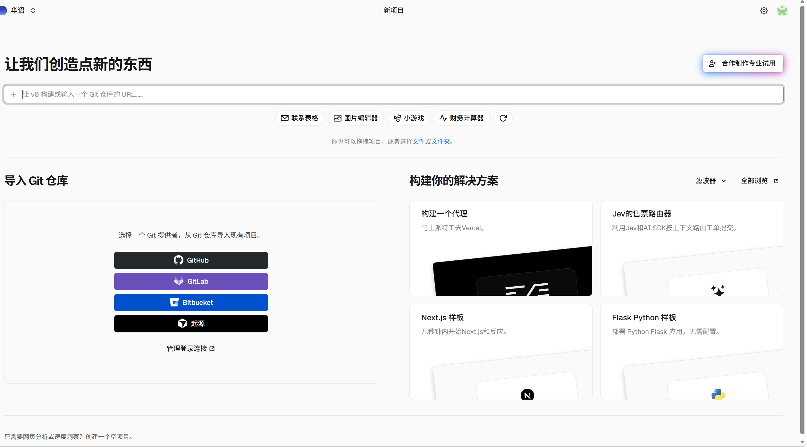
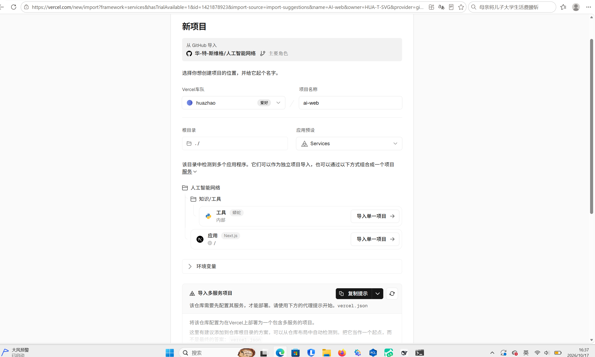

# 把本项目部署到自己的 GitHub + Vercel（图文步骤）

**适用对象**：拿到本项目代码、想自己部署一份的人
**预计耗时**：40–60 分钟（其中 5–10 分钟是等 Vercel 构建）
**你需要**：GitHub 账号、Vercel 账号（可用 GitHub 登录）、电脑上装 Git；如果本地要跑起来还要 Node ≥ 24 与 pnpm；一个可用的 OpenAI 兼容大模型接口（含 Key）

> 本文的每一步都在真实环境里走过一遍，截图是当时操作的真实界面。⚠️ 标记的是**踩过的坑**，不是理论风险。

## 目录

1. 先搞清楚：你要部署的是个什么东西
2. 准备：账号与本地环境
3. 第一步：拿到代码
4. 第二步：上传到自己的 GitHub
5. 第三步：在 Vercel 导入并部署
6. 第四步：验证部署成功
7. 可选：绑定自己的域名
8. 可选：部署到自己的云服务器（VPS）
9. 关于「能不能部署到我这边的云服务」
10. 常见问题（都是真实踩过的）
11. 安全提醒
12. 命令速查表

# 1 先搞清楚：你要部署的是个什么东西

这不是一个「前端页面 + 后端服务」的常规项目，而是**几乎全部计算都在浏览器里跑**的应用：

| 组成 | 跑在哪 | 说明 |
| --- | --- | --- |
| 页面与交互（Next.js 16） | 浏览器 | 静态路由，Vercel 只负责把 HTML/JS 发出去 |
| 数据解析、质量检查、清洗、导出 | **浏览器**（含 Web Worker） | 上传的文件不会离开用户电脑 |
| 端侧语义模型（23 MB）+ 推理运行时（53 MB） | **浏览器**（WebGPU / WASM） | 站点自己托管，不走第三方 CDN |
| 大模型调用 | 服务器（一个转发接口 `/api/agent`） | 只转发聚合后的「结构摘要」，不碰原始数据 |

**对部署的含义**：

- 服务器很轻，**免费额度通常够用**（Vercel Hobby 即可）；
- 但**首次打开页面要认真下载 76 MB 静态资源**（模型 + 推理运行时），所以别指望「秒开」；
- 那两个资源**不在 Git 仓库里**（`.gitignore` 掉了），是**构建时下载/拷贝**的 —— 这点非常重要，见第 5 节。

# 2 准备：账号与本地环境

| 准备项 | 说明 |
| --- | --- |
| GitHub 账号 | 代码托管 |
| Vercel 账号 | 用 GitHub 账号一键登录最省事 |
| Git | 命令行要有 `git`；Windows 装 Git for Windows 即可 |
| Node ≥ 24 + pnpm | **只有想在本地跑/改代码才需要**；纯部署可以跳过 |
| 大模型接口 | 形如 `https://api.deepseek.com` 的 OpenAI 兼容地址 + 一个 Key |

本地环境检查（可选）：

```powershell
git --version
node -v      # 期望 v24.x
pnpm -v
```

# 3 第一步：拿到代码

有两种方式，**推荐 A（Fork）**，因为它能同步原作者的后续更新。

## A. Fork（推荐）

1. 打开原仓库页面（例如 `https://github.com/HUA-T-SVG/AI-web`）；
2. 点右上角 **Fork** → 选自己的账号 → 得到一个 `你的用户名/AI-web`；
3. 这个副本就是你的仓库了，可以直接进第 5 节部署。

## B. 下载 ZIP 再自己建仓库

1. 仓库页 → **Code** → **Download ZIP**；
2. 解压到一个**路径里不要有中文和空格**的目录（例如 `D:\projects\ai-web`）；
3. 进目录，初始化 Git：

```powershell
cd D:\projects\ai-web
git init
git add .
git commit -m "init: 导入项目代码"
```

# 4 第二步：上传到自己的 GitHub

## 4.1 新建一个空仓库

GitHub 右上角 **+** → **New repository** → 填名字（例如 `ai-web`）→ **不要勾** Add a README / .gitignore / license（勾了会多出一个提交，后面推送会冲突）→ Create。

建好后页面会显示「快速设置」，里面就是你要复制到本地的命令（下图是真实界面）：


〔图 1：新建空仓库后，页面直接给出推送命令（线上真实界面）〕

## 4.2 推送代码

**情况一：你是「下载 ZIP 自己建仓库」（对应上图下方那段命令）**

```powershell
cd D:\projects\ai-web
git remote add origin https://github.com/你的用户名/ai-web.git
git branch -M main
git push -u origin main
```

**情况二：你是 Fork 的**

Fork 出来的仓库里已经有代码了，**不用推送**，直接进第 5 节。

## 4.3 ⚠️ 第一次推送会要求登录

Windows 上会弹出浏览器让你授权 GitHub（Git Credential Manager）。**选「浏览器登录」**，授权一次之后凭证会记住。

如果命令行里卡在 `Username for 'https://github.com':`，说明没弹出登录窗口：按 `Ctrl+C` 中断，然后执行一次 `git config --global credential.helper manager`，再重新 push。

## 4.4 ⚠️ 别把密钥推上去

检查一下有没有 `.env.local` 被提交：

```powershell
git ls-files | findstr env
```

正常应该只看到 `.env.example`。`.gitignore` 里已经写了 `*.env.local`，**不要手动改掉它**。

# 5 第三步：在 Vercel 导入并部署

## 5.1 导入仓库

1. 登录 [vercel.com](https://vercel.com) → **Add New… → Project**；
2. 在「导入 Git 仓库」里点 **GitHub**，授权后选中你刚才那个仓库：


〔图 2：Vercel 新项目页，选择 GitHub 导入（线上真实界面）〕

## 5.2 ⚠️ 关键一步：它可能说「检测到多个应用程序」

这个仓库里除了主应用，还有别的目录，Vercel 会把仓库识别成「多服务项目」，然后要求你配 `vercel.json`。**不要走那条路**：

在检测结果里选 **「应用 · Next.js」那一条 → 点「导入单一项目」**（下图中间偏下的两个按钮）：


〔图 3：Vercel 项目配置页，上方的「导入单一项目」才是正确选择（线上真实界面）〕

选对之后，后面的「根目录 `./`」「框架 Next.js」保持默认即可。

## 5.3 填三个环境变量（必填）

在 **Environment Variables** 里加这三条（**只加在服务端，不要加 `NEXT_PUBLIC_` 前缀**）：

| 变量名 | 填什么 | 例子 |
| --- | --- | --- |
| `LLM_API_KEY` | 你的大模型 Key | `sk-...` |
| `LLM_BASE_URL` | OpenAI 兼容地址 | `https://api.deepseek.com` |
| `LLM_MODEL` | 模型名 | `deepseek-chat` |

> 截图时把 Key 那一列遮掉，或者用 Vercel 环境变量输入框右侧的「敏感值」开关（显示成点）。

## 5.4 点 Deploy，然后耐心等 3–6 分钟

⚠️ **构建里有两个「下载」步骤，不是卡住了**：

| 构建阶段 | 做什么 | 耗时 |
| --- | --- | --- |
| `prebuild` → `scripts/fetch-model.mjs` | 下载端侧模型（约 23 MB）到 `public/models/` | 1–3 分钟 |
| `prebuild` → `scripts/sync-ort-wasm.mjs` | 把推理运行时的 WASM（约 53 MB）拷到 `public/ort/` | 10–30 秒 |
| `next build` | 编译 Next.js | 1–2 分钟 |

这两个目录**不在仓库里**（`.gitignore` 掉了），所以**必须是构建时产生**。如果构建日志里没看到这两步，说明 `package.json` 的 `prebuild` 被改坏了。

## 5.5 部署完成后

Vercel 会给你一个形如 `https://你的项目名.vercel.app` 的地址。**先别急着分享**，见下一节验证。

# 6 第四步：验证部署成功

按顺序点一遍，全部通过才算成功：

| # | 验证 | 期望结果 | 失败时看 |
| --- | --- | --- | --- |
| 1 | 打开首页 | 出现「把数据文件拖到这里」上传区 | 打不开 = 构建失败，回 Vercel 看日志 |
| 2 | 上传一个 CSV/XLSX | 出现预览表格，无报错 | 解析报错 = 文件编码或格式问题 |
| 3 | 点「质量检查」 | 出现列画像与问题清单 | 空白 = 检查引擎异常 |
| 4 | 看状态条 | 十几秒后变成「语义归并已就绪，本次检查包含 L3 语义层」 | 若显示「语义归并不可用」，见 10.4 |
| 5 | 点「AI 分析」并随便问一句 | 有流式回答 | 报「接口地址或密钥无效」= 环境变量填错 |

⚠️ **第 4 步最容易被忽略**：它是判断「端侧模型是否真的能加载」的唯一地方。首次会下载 76 MB，慢是正常的。

# 7 可选：绑定自己的域名

如果你有自己的域名（例如 `mydomain.com`）：

1. Vercel 项目 → **Settings → Domains → Add**，填 `ai.example.com`；
2. Vercel 会给你一条 CNAME 记录，去域名服务商（阿里云/腾讯云/Cloudflare）添加；
3. 等 DNS 生效（几分钟到几小时），Vercel 自动签发 HTTPS 证书。

⚠️ **一个域名不能同时指向两个平台**。如果你已经把它绑在你的那台上，别人再用就要用子域名（如 `friend.你的域名.com`）。

# 8 可选：部署到自己的云服务器（VPS）

如果你不想用 Vercel，而是有一台阿里云/腾讯云的 Linux 服务器，也能跑（本项目只需 Node 常驻进程 + 静态文件）。

## 8.1 服务器上准备

```bash
# 以 Ubuntu 22.04 为例
curl -fsSL https://deb.nodesource.com/setup_24.x | sudo -E bash -
sudo apt install -y nodejs git
sudo npm i -g pnpm
```

## 8.2 拉代码、构建、启动

```bash
cd /opt
sudo git clone https://github.com/你的用户名/ai-web.git
cd ai-web
pnpm install
# 环境变量写进 .env.local（只放服务端）
printf 'LLM_API_KEY=sk-你的key\nLLM_BASE_URL=https://api.deepseek.com\nLLM_MODEL=deepseek-chat\n' | sudo tee .env.local
pnpm build          # 这一步会下载模型与 WASM，需要能访问外网
pnpm start          # 默认监听 3000
```

## 8.3 用 Nginx 反代 + HTTPS

```nginx
server {
    listen 80;
    server_name ai.example.com;
    client_max_body_size 60m;

    location / {
        proxy_pass http://127.0.0.1:3000;
        proxy_http_version 1.1;
        proxy_set_header Upgrade $http_upgrade;
        proxy_set_header Connection "upgrade";
        proxy_set_header Host $host;
        proxy_read_timeout 300s;   # SSE 流式回答，别用默认 60s 掐断
    }
}
```

证书用 `certbot --nginx` 一把梭。

## 8.4 ⚠️ 自建时的三个注意点

1. **`proxy_read_timeout` 必须调大**（默认 60s 会把 AI 流式回答掐断，表现为「回答到一半停住」）；
2. **模型文件在 `public/` 下**，`pnpm build` 之后才存在；如果 `pnpm install --prod` 之类跳过了 `prebuild`，页面会一直卡在「语义归并准备中」；
3. 服务器要能访问 GitHub 与模型源（境内机器常被卡），否则构建阶段就失败。

# 9 关于「能不能部署到我这边的云服务」

先说清「我这边的云服务」实际是什么：**一个 Vercel 账号 + 一个自定义域名**，没有独立的服务器。所以三种选择：

| 方案 | 怎么做 | 代价 / 限制 |
| --- | --- | --- |
| **A. 朋友用自己的 Vercel（推荐）** | 按第 5 节，用自己的账号导入自己的仓库 | 免费；地址是 `xxx.vercel.app`；**境内可能打不开**，要自己域名 |
| **B. 用我的 Vercel 账号** | 把我的仓库 Fork 后，用我的账号再 Import 一个**新项目**（名字如 `ai-web-friend`），再绑子域名 `friend.ai-web.me` | 两人共用一个账号与**同一个 API Key 额度**；Hobby 免费额度有限，构建次数也算；出问题互相影响 |
| **C. 用我的云服务器** | 按第 8 节，把代码跑在我的 VPS 上，Nginx 绑子域名 | 需要我有一台能跑 Node 24 的服务器；模型 76 MB 与流量都占带宽 |

**方案 B 的具体操作**（如果你确实想放在我的账号下）：

1. 朋友先按第 4 节把自己的 Fork 弄好；
2. 我在 Vercel 里 **Add New → Project**，导入**朋友的仓库**（需要我在 GitHub 上有该仓库的访问权，或先 Transfer 给我）；
3. 项目名 `ai-web-friend`，环境变量**先用我自己的 Key**（额度共用），或让朋友填自己的；
4. 域名加 `friend.ai-web.me` → 去阿里云 DNS 加一条 CNAME 指向 `cname.vercel-dns.com`；
5. 验证：访问 `https://friend.ai-web.me`。

⚠️ **不建议**：两个人往同一个 Vercel 项目上反复 push —— 会互相覆盖、互相触发部署，出问题很难查。**一个部署一个项目**。

# 10 常见问题（都是真实踩过的）

## 10.1 `*.vercel.app` 在境内打不开

真实原因：那个域名在境内被阻断，不是你的项目坏了。
解决：绑自己的域名（第 7 节）。这是当初必须买域名唯一的原因。

## 10.2 端侧模型下载失败 / 页面一直「语义归并准备中」

三个层次的原因，按顺序排查：

1. **构建时没生成 `public/models/`** → 看构建日志有没有 `fetch-model.mjs`；
2. **模型源在境内不可达**：脚本已内置镜像回退，若仍失败，改用手动上传（把模型放进 `public/models/` 后重新部署）；
3. **浏览器加载被 CORS 拦**：必须**同源**提供（`public/models/` 就是为此），不要改成第三方 CDN 地址。

## 10.3 打开页面很慢 / 白屏几秒

正常：首次要下 76 MB（模型 23 MB + 推理运行时 53 MB）。第二次打开走浏览器缓存会快很多。
如果一直白屏：看 Network 里 `/models/...` 与 `/ort/...` 是否 404 —— 404 说明构建没生成这些文件。

## 10.4 语义检查不可用（状态条写着「未完成（已降级）」）

可能原因：浏览器不支持 WebGPU 且 WASM 也被禁用、或资源 404。
本项目已做**降级处理**：语义不可用时，确定性检查照常跑，界面上会明确写「本次没有被检查」——**这是设计好的诚实行为，不是 bug**。

## 10.5 AI 分析报「接口地址或密钥无效」

- 环境变量拼错（尤其 `LLM_BASE_URL` 末尾多了 `/v1`，不同供应商要求不同）；
- **改完环境变量必须重新部署**（Vercel 不会自动让旧部署读到新变量）：Deployments → 最新那条 → ⋯ → Redeploy。

## 10.6 构建成功但页面 500

多数是 Node 版本不对。仓库里有 `.node-version`（24），Vercel 会读它；如果你改过 `package.json` 的 `engines` 或删了 `.node-version`，先恢复。

## 10.7 `git push` 一直超时 / 连不上 GitHub

真实高频问题：`Failed to connect to github.com port 443: Timed out`。
**这是网络问题，不是配置问题**：重试几次通常就过了；仍不行就换网络/开代理，别去改 git 配置。

## 10.8 改了代码但线上没变化

- 确认推的是 **main 分支**（Vercel 默认监听 main）；
- 确认 Vercel 里那次部署是 **Ready** 而不是 **Error**；
- 浏览器强刷（Ctrl+F5），Vercel 有 CDN 缓存。

# 11 安全提醒

| 事项 | 说明 |
| --- | --- |
| **Key 只放服务端** | 环境变量名不要加 `NEXT_PUBLIC_`，那样会被打进浏览器 JS |
| **别提交 `.env.local`** | `.gitignore` 已覆盖；别 `git add -f` 强推 |
| **截图遮 Key** | 展示环境变量页面时用敏感值开关，或打码 |
| **公开地址=公开配额** | 本项目接口**没有鉴权与限流**，任何人打开你的站点都能消耗你的模型额度。演示够用，长期公开建议加限流 |
| **别把 `.env.local` 发给别人** | 要给别人用就让他自己填 |

# 12 命令速查表

```powershell
# —— 本地跑起来（可选）——
pnpm install
pnpm dev                 # http://localhost:3000

# —— 上传代码 ——
git remote add origin https://github.com/你的用户名/ai-web.git
git branch -M main
git push -u origin main

# —— 提交改动 ——
git add .
git commit -m "说明这次改了什么"
git push

# —— 部署相关（都在网页上做）——
# Vercel → Add New → Project → 导入仓库 → 填 3 个环境变量 → Deploy
# 改完环境变量：Deployments → 最新 → ⋯ → Redeploy
```

**最后一句**：部署完务必跑一遍第 6 节的 5 条验证 —— 尤其是第 4 条（语义就绪）。很多「看起来部署成功」的项目，其实是端侧模型没加载，只是没人点到那一页。
